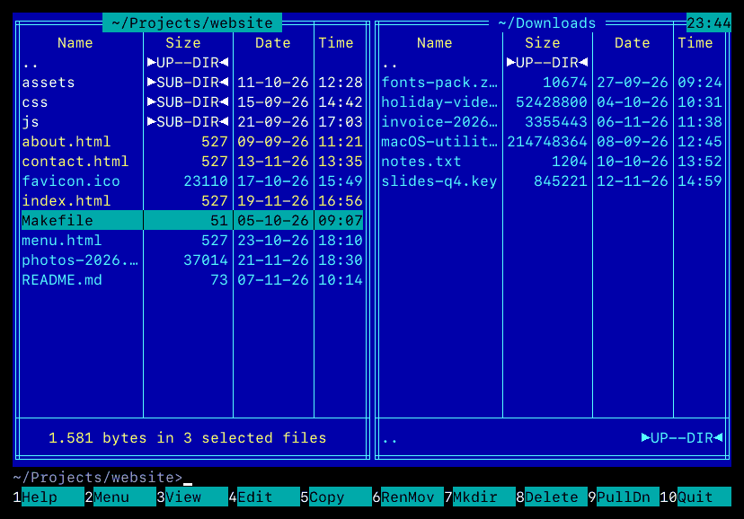

# ncmac

A fast two-panel file manager for the macOS terminal, in the style of the classic DOS commanders: blue panels, function-key bar, command line, and keys your fingers still remember. It is a single native C++17 binary and uses only system libraries. (Nederlands: [README.nl.md](README.nl.md))



## Install

**Homebrew**

```sh
brew tap wvdheiden/tap
brew trust wvdheiden/tap        # Homebrew 7+: allow this third-party tap
brew install ncmac
```

**Installer package:** download the signed and notarized `ncmac-<version>.pkg` from [Releases](https://github.com/wvdheiden/ncmac/releases). It installs to `/usr/local/bin`.

**From source**

```sh
make && make install PREFIX=~/.local
```

### Shell integration (recommended)

Add one line to `~/.zshrc`. You then start ncmac with `ncm`, and after F10 your shell is in the directory you were in:

```sh
source "$(brew --prefix)/share/ncmac/ncm.zsh"      # Homebrew
source /usr/local/share/ncmac/ncm.zsh               # .pkg
```

## Terminal setup

* **Terminal.app:** Settings → Profiles → Keyboard → enable **Use Option as Meta key**. Alt-F7, Alt+letter quick search and similar keys need this.
* **iTerm2:** Profiles → Keys → Left Option key = **Esc+**.
* **Function keys:** in System Settings → Keyboard, enable **Use F1, F2, etc. keys as standard function keys**, or hold `fn`.
* **No function keys** (for example an iPad keyboard): press **Ctrl-F**, then `1`…`9`, `0` for F1…F10. Put `s`, `a` or `c` before the digit for Shift, Alt or Ctrl. You can also tap the key bar.
* `ncmac --keytest` shows the codes your terminal sends for each key.

## Keys

| Key | Action |
|---|---|
| F1 F2 F3 F4 | help, user menu, view, edit |
| F5 F6 F7 F8 | copy, rename/move, mkdir, delete (to Trash) |
| F9 F10 | pull-down menu, quit |
| Shift-F4 / Shift-F6 / Shift-F8 | edit new file, rename in place, delete permanently |
| Alt-F1 / Alt-F2 | choose a volume or favourite for the left/right panel |
| Alt-F7 / Alt-F8 / Alt-F9 / Alt-F10 | find file, history, 25/43/50 lines, directory tree |
| Ctrl-F1 / Ctrl-F2 | left/right panel on/off |
| Ctrl-F3 … F7 | sort by name / extension / time / size / unsorted |
| Tab | other panel |
| Insert, Ctrl-T | mark file |
| `+` `-` `*` | select group, unselect group, invert selection |
| Alt+letter, Ctrl-S | quick search |
| Ctrl-O | hide panels (user screen with its own prompt) |
| Ctrl-P / Ctrl-U / Ctrl-L / Ctrl-R | other panel on/off, swap, info, re-read |
| Ctrl-PgUp / Ctrl-PgDn / Ctrl-\\ | parent directory, enter directory/archive, root |
| Ctrl-E / Ctrl-X | previous / next command |
| Ctrl-J / Alt-Enter | put file name / full path on the command line |
| Shift-F9 | save setup |
| Alt-. | show/hide hidden files (dotfiles and Finder-hidden; shown dimmed), also F9 → Options |

**Enter** opens what is under the cursor:
* a directory or an archive is shown in the panel;
* a script is run;
* anything else opens in its macOS app.

**Archives** open like directories, read-only. Supported formats: zip, tar.gz/bz2/xz/zst, 7z, rar, iso, cpio, xar, cab, jar, deb, rpm and more (via the system libarchive). F3 views a file in the archive and F5 extracts files to the other panel.

**F8** moves to the Trash, the same way Finder does. You can switch this off under F9 → Options.

**Mouse:** click to select, double-click to open, right-click to mark, scroll with the wheel. Clicking the key bar presses that key.

## User menu (F2)

The menu lives in `~/.config/ncmac/menu`; a `.ncmenu` file in a directory takes precedence there.

```
g: Git status
    git status
z: Zip selection
    zip -r archive.zip %s
```

Substitutions: `%f` current file, `%s` selection, `%d` current directory, `%o` the other panel's directory.

## License

MIT, see [LICENSE](LICENSE).
