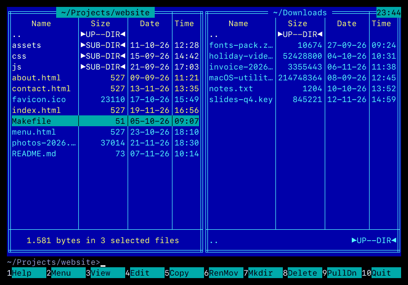

# twinc

(Voorheen **ncmac**.) Een two-panel filemanager voor de terminal op macOS, Linux en Windows, in de stijl van de klassieke DOS-commanders. Eén native binary in C++17, geen dependencies. (English: [README.md](README.md))



## Installeren

```sh
brew tap wvdheiden/tap
brew trust wvdheiden/tap                  # Homebrew 7+: deze tap toestaan
brew install twinc
```

Of download van de [GitHub-releases](https://github.com/wvdheiden/twinc/releases):
* **macOS:** de ondertekende `twinc-<versie>.pkg`;
* **Linux:** een `.deb` voor Debian en Ubuntu (`sudo apt install ./twinc_<versie>_amd64.deb`) of een `.tar.gz` voor andere distributies, voor x86_64 en arm64. Nodig: libarchive.
* **Windows:** `twinc-<versie>-windows-x86_64.zip`. Pak hem uit en zet `twinc.exe` in een map die in je `PATH` staat. Het is één bestand, er hoeft niets anders bij. Werkt op Windows 10 (versie 1903 of nieuwer) en Windows 11, het best in Windows Terminal.

Of bouw zelf (C++17-compiler en libarchive; op Linux ook `libarchive-dev`; op Windows in een MSYS2 UCRT64-shell met `mingw-w64-ucrt-x86_64-gcc` en `mingw-w64-ucrt-x86_64-libarchive`):

```sh
make && make install PREFIX=~/.local
```

Zet daarna dit in `~/.zshrc` of `~/.bashrc`. Dan start je met `ncm`, en na F10 staat je shell in de map waar je in twinc was:

```sh
source "$(brew --prefix)/share/twinc/ncm.sh"   # Homebrew
source /usr/local/share/twinc/ncm.sh            # macOS .pkg
source /usr/share/twinc/ncm.sh                  # Linux .deb
```

In PowerShell zet je `ncm.ps1` uit de Windows-zip in je profiel (`notepad $PROFILE`):

```powershell
. "C:\Tools\twinc\ncm.ps1"
```

`nc` zelf is al netcat; wil je toch `nc` typen, zet dan `alias nc=ncm` in je shell-configuratie.

## Terminal-instellingen (belangrijk)

* **Linux:** de meeste terminals (GNOME Terminal, Konsole, xterm, kitty) werken zo. Sommige desktops pakken F1, F10 of Alt-F1…F10 zelf af; zet die sneltoetsen uit in de terminal- of desktopinstellingen, of gebruik Ctrl-F (hieronder).
* **Windows Terminal:** functietoetsen, Alt en de muis werken zo. Alt-Enter (volledig pad op de commandoregel) en F11 gebruikt Windows Terminal zelf voor volledig scherm; Alt-Enter krijg je terug door die sneltoets te verwijderen onder Instellingen → Acties.
* **Terminal.app** → Instellingen → Profielen → Toetsenbord: vink **"Gebruik Option als Meta-toets"** aan (voor Alt-toetsen zoals Alt-F7 en Alt+letter quick search).
* **iTerm2** → Profiles → Keys: Left Option = **Esc+**.
* Systeeminstellingen → Toetsenbord: **"Gebruik F1, F2 enz. als standaard functietoetsen"**, anders moet je `fn` erbij houden. Mission Control pakt sommige Ctrl-F-toetsen af; alles zit ook in het F9-menu.
* Geen F-toetsen (iPad)? **Ctrl-F, dan 1…9, 0** = F1…F10. Zet `s`, `a` of `c` vóór het cijfer voor Shift, Alt of Ctrl (Ctrl-F `a` `7` = Alt-F7). Je kunt ook op de toetsenbalk tikken, of snel `Esc 1` … `Esc 0` typen.
* `twinc -s 80x25` zet het terminalvenster op 80×25 (en zet het bij afsluiten terug). Alt-F9 schakelt 25/43/50 regels.

## Toetsen

| Toets | Functie |
|---|---|
| F1 / F2 / F3 / F4 | help / user menu / view / edit |
| F5 / F6 / F7 / F8 | copy / rename-move / mkdir / delete (naar de Prullenmand) |
| Shift-F8 | definitief verwijderen (in de Prullenmand zelf is F8 ook definitief) |
| F9 / F10 | pull-down menu / quit |
| Shift-F4, Shift-F6 | nieuw bestand editen, hernoemen ter plekke |
| Alt-F1 / Alt-F2 | "drive" kiezen (volumes in /Volumes, home, favorieten) |
| Alt-F7 / Alt-F8 / Alt-F9 | find file / history / 25-43-50 regels |
| Alt-F10 | directory tree: →/`+` uitklappen, ←/`-` inklappen of naar ouder, `*` alles eronder uitklappen, typen = zoeken, Enter = ga erheen |
| Ctrl-F1 / Ctrl-F2 | linker/rechter paneel aan/uit |
| Ctrl-F3 … F7 | sorteren op naam / extensie / tijd / grootte / ongesorteerd |
| Tab | ander paneel |
| Insert, Ctrl-T | bestand markeren |
| `+` `-` `*` | groep selecteren / deselecteren / inverteren (met lege commandoregel) |
| Alt+letter, Ctrl-S | quick search |
| Ctrl-O | panelen weg: user screen met uitvoer en een eigen prompt |
| Ctrl-P / Ctrl-U / Ctrl-L / Ctrl-R | ander paneel aan/uit / panelen wisselen / info / herlezen |
| Ctrl-PgUp / Ctrl-PgDn / Ctrl-\\ | map omhoog / map in (ook .app) / root |
| Ctrl-E / Ctrl-X | vorig / volgend commando |
| Ctrl-J (Ctrl-Enter) / Alt-Enter | bestandsnaam / volledig pad op de commandoregel |
| Esc | commandoregel wissen |
| Shift-F9 | setup opslaan |
| Alt-. | verborgen bestanden tonen/verbergen (dotfiles en in Finder verborgen; in een gedimde kleur), ook via F9 → Options |

Enter op een bestand: een map gaat open; een archief gaat open als map; een script of programma wordt uitgevoerd (op Windows `.exe`, `.bat`, `.cmd` en `.ps1`); al het andere opent met de standaard-app (`open` op macOS, `xdg-open` op Linux, het gekoppelde programma op Windows). Zonder desktop, bijvoorbeeld via SSH, opent het in de ingebouwde viewer.

### Archieven

Enter op een zip, tar(.gz/.bz2/.xz/.zst), tgz, 7z, rar, iso, cpio, xar, cab, jar, deb, rpm … opent het archief als map (via libarchive). Ctrl-PgDn probeert élk bestand als archief te openen. Binnen een archief:

* bladeren, quick search, markeren werken gewoon; `..` in de bovenste map brengt je terug
* F3 bekijkt een bestand, Enter opent het met de standaard-app (via een tijdelijke kopie)
* F5 kopieert (uitpakken) naar het andere paneel, ook hele mappen
* archieven zijn alleen-lezen: F4/F6/F7/F8 geven een melding
* entries met `../` of absolute paden worden genegeerd (geen "zip slip") `cd`, `cd..`, `cd -` en `cd ~` worden intern afgehandeld.

Muis: klik selecteert, dubbelklik opent, rechtsklik markeert, het wiel scrollt en een klik op de toetsenbalk drukt die toets in.

## User menu (F2)

`~/.config/twinc/menu`, op Windows `%APPDATA%\twinc\menu` (een `.ncmenu` in een map gaat voor). Commando's draaien in je shell: `$SHELL` op macOS en Linux, `cmd.exe` op Windows. Formaat:

```
g: Git status
    git status
z: Zip selectie
    zip -r archive.zip %s
```

`%f` huidig bestand, `%s` selectie, `%d` huidige map, `%o` map van het andere paneel, `!.!` = `%f`.

## Bestanden

* `~/.config/twinc/twinc.conf`: setup (Shift-F9)
* `twinc --keytest`: laat zien welke code je terminal voor een toets stuurt en hoe twinc die leest
* `~/.config/twinc/history`: commandogeschiedenis

F8 gebruikt dezelfde Prullenmand als Finder, ook die op USB- en externe schijven. Op Linux is dat de prullenbak van je desktop (`~/.local/share/Trash`) en op Windows de Prullenbak, dus terugzetten kan vanuit je bestandsbeheerder of Verkenner. Lukt dat niet (bijvoorbeeld op een netwerkschijf), dan vraagt twinc of het definitief mag. Uitzetten kan via F9 → Options → "Delete to Trash" (en Shift-F9 om dat te bewaren).
